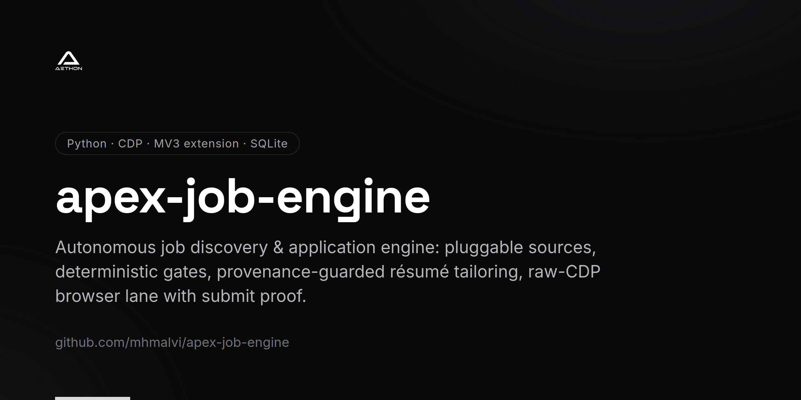
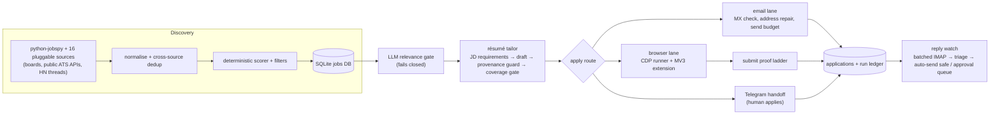

<!-- repo-card -->


# APEX — autonomous job discovery & application engine

A self-hosted pipeline that finds job postings, gates them, tailors a résumé per posting under a provenance guard, applies through email, web forms and a CDP-driven browser lane, and only counts an application as sent when the employer's own page or mailbox says so.

Status: running in production on a self-hosted server since June 2026.

## Problem

Applying to jobs at volume breaks in quiet ways. Postings are spread over dozens of boards and ATS products. Every application form is built differently: shadow DOM, iframes, ARIA comboboxes, honeypot fields, modal file choosers. LLM-written résumés invent metrics and tools the applicant does not have. Worst of all, a script that clicks "Submit" will happily report success while the browser sits on a login wall. APEX treats this as a systems problem. It is a pipeline of deterministic gates around the few steps that really need a model. Every outbound action has an explicit stop condition, and "applied" means there is proof.

## Architecture



- **Discovery.** Sources implement one small interface (`enabled()`, `fetch(term, location, ...)`) and return rows in the pipeline's normalised schema. They run in parallel, each under its own time budget, and are merged before dedup and scoring. A failing or rate-limited source returns nothing and never stops a run.
- **Scoring and gates.** A deterministic scorer (skill match, seniority, freshness, filters) ranks jobs. An LLM relevance gate then decides whether a role is in the target family. Gate verdicts are cached only when a trusted model gave a definite answer.
- **Résumé tailor.** Requirements are extracted from the posting without an LLM. The model rewrites the base résumé, a provenance guard strips anything the base does not back, an ATS-coverage score gates the result, and the model is asked again with the violations named. PDFs are rendered with fpdf2.
- **Email lane.** Recipients are extracted from the posting, repaired when a scraped address is truncated, and checked for MX/A records. The lane also enforces a cross-lane daily send budget and a suppression list fed by bounce detection.
- **Browser lane.** A Python runner drives Chromium over the raw Chrome DevTools Protocol (websockets): real input events, intercepted file choosers, account-wall and closed-posting detection. A Chrome MV3 extension with per-ATS drivers (Greenhouse, Ashby, Workable, Lever, Workday, Google Forms) does the in-page field work. The extension fills by default and presses Submit only when the server issues a grant.
- **Proof.** After a press, the runner reads the page for up to ten seconds and records `confirmed` only on a confirmation URL or new confirmation copy. Anything else is `unconfirmed`, with the evidence attached.
- **Review and replies.** A Telegram bot shows cards, previews and handoffs. An hourly reply watcher fetches all watched mail in one batched IMAP pass, triages it, auto-sends only fixed, safe replies, and queues everything else for approval.
- **Operations.** Lanes run as systemd timers. Every run writes a ledger row, and digests go to Telegram and a Google Sheet mirror.

## Hard engineering decisions

### 1. JD requirements are extracted deterministically, with no LLM

**Decision.** A posting is read with a persona lexicon (term → category + ATS-equivalent synonyms) plus structure from the posting itself. Terms under a "Requirements / Qualifications / What you'll bring" header are must-have. CamelCase/ALLCAPS tokens become candidate tools, but never must-haves. "N+ years ... experience" is captured, and the cleaned title's function words count as requirements. `coverage()` scores the rendered résumé against that weighted list.
**Why.** This list is what the résumé is judged against. It has to be reproducible, inspectable and free of hallucinated demands. The extractor it replaced was a hard-coded engineering keyword list, which returned "not available" on every non-engineering posting.
**Trade-off.** Lexicons need upkeep, and section detection depends on postings using recognisable headers. Synonyms matter for provenance too: a missing synonym turns a real qualification into a "violation".

### 2. The model's output is checked, not trusted: provenance guard + re-ask

**Decision.** After every tailoring pass the draft is checked against the base résumé. Three things are flagged: any number not in the base (a percentage and its bare digits license each other), any results word such as quota, target or exceeded that the base never uses, and any tool, domain, credential or acronym the base never mentions. Offending bullets revert to the base bullet at that position. The model is then re-asked with the violations listed. Drafts are ranked on (introduces new vocabulary, clean, coverage), in that order.
**Why.** The prompt already says "never invent a number or tool", and live drafts still inserted domains and acronyms the applicant never had. A rule the model is asked to follow is not a guarantee. A deterministic check after the fact is.
**Trade-off.** A stripped draft reads closer to the base, which the "is it really tailored?" check (a vocabulary set difference, so reordering sentences does not count) can then refuse. Selection therefore prefers a clean draft over a higher-coverage stripped one, and a stripped draft is retried even above the coverage floor.

### 3. A click is not a submission

**Decision.** The runner never records "applied" because Submit was pressed. It reads the page and walks a ladder. A confirmation-shaped path that changed from the opened URL confirms. So does confirmation copy that was **not** on the page before the click, read through a `hold_submit` pause between the fill and the press. Visible validation errors, or a landing on the site's job search, an apply opener or a job-alert box, count as rejected. Fields that existed before the click and are now gone are recorded as evidence, never as proof.
**Why.** An audit of the early "submitted" rows found most of them had landed on a login wall or a search page. A server grant only means a click was allowed. A form disappearing looks identical from outside whether it was sent or replaced by a sign-in screen.
**Trade-off.** The lane under-reports. Some genuine submissions end as `unconfirmed` and need a human glance, which is accepted because over-reporting is the failure that misleads decisions. It reads `body.innerText` rather than `textContent`, because single-page apps ship their own confirmation sentence inside the JS bundle.

### 4. Raw CDP over desktop automation for the unattended lane

**Decision.** Clicks go through `Input.dispatchMouseEvent` in viewport coordinates. Uploads arm `Page.setInterceptFileChooserDialog`, press the control, catch `Page.fileChooserOpened`, and answer with `DOM.setFileInputFiles` on the backend node the chooser names. Arming, clicking and waiting all happen on one websocket session, which parks events that arrive while it waits for a command reply.
**Why.** The native GTK chooser is modal. While it was up, the page received no pointer events at all, and every later field write silently failed. Screen-coordinate tools (xdotool) were also exposed to wrong-DISPLAY, offset and zoom faults. CDP events carry a user gesture and hit the renderer directly.
**Trade-off.** The project owns its own CDP plumbing: tab/target matching between the extension's view and CDP's view, dialog handling, hung-tab cleanup. Some widgets still need special paths. The Google Forms Picker ignores untrusted file writes, so the runner writes the picker iframe's input over CDP and checks that the form lists the file.

### 5. The extension fills and refuses honeypots; it presses Submit only on a grant

**Decision.** The MV3 extension walks the page through open shadow roots and visible same-origin frames. It resolves labels and fills through native value setters so React and Angular state updates. It never writes a field judged to be a trap: one labelled "for robots", or one hidden from people (aria-hidden, clipped to nothing, too small to see, parked off the document, `tabindex=-1`) with no visible label. The write loop re-checks the scanner's verdict even if the server's plan says `set`. Interactive captchas (reCAPTCHA v2, hCaptcha, managed Turnstile) hand the job off. Passive ones (v3, invisible Turnstile) are only reported. Submit is pressed only after the server issues a grant.
**Why.** Filling a honeypot marks the application as a bot's. The same "hidden input" shape is also how ATSes build custom comboboxes, so the rule is "hidden **and** unlabelled". One ATS page measured zero inputs in the light DOM, with every field inside shadow roots.
**Trade-off.** Captcha-gated forms and some account walls become human handoffs instead of applications. Measuring off-screen against the document rather than the viewport was a fix: an earlier version treated fields scrolled past as traps.

### 6. Every gate fails closed, and outages must not look like quiet days

**Decision.** LLM gates (relevance, recipient, cover-letter QA) refuse on error. A verdict the parser cannot read is "undecided", never "rejected", and it is not cached. A tracker classifies errors as quota, auth or transient, and leads the digest with an alert when applications were blocked. A "dry run" passes `persist=False` down to every write site. The reply drafter's send path raises if the body still contains the `[[NEEDS YOUR INPUT]]` placeholder.
**Why.** Twice, a run reporting "Done 0" was hiding an outage (exhausted LLM credits, a scheduler misfire), not a quiet day. A classifier that fails open had once surfaced every auto-acknowledgement as an employer reply. An unreadable verdict that got cached as a rejection would block a job for good.
**Trade-off.** During an LLM outage the system sends nothing and says so loudly. Throughput depends on model availability, which is why fallback routes exist and why only verdicts from trusted hosted models are cached.

### 7. Sources are pluggable, best-effort and bounded — and some boards are deliberately not read

**Decision.** Each source owns its quotas and API keys (read from the environment) and self-disables without them. A per-source budget stops it from starting new queries after a fixed time but keeps the rows it already fetched. Sources that ignore location get each search term only once. Public employer boards are read only through APIs their ATS publishes for that purpose, after checking robots.txt and terms. Platforms whose terms or robots.txt bar automated access are listed in the code with the reason and skipped.
**Why.** An earlier flat timeout threw away every row a slow source had already fetched. A single failing source must never take discovery down.
**Trade-off.** Less coverage on some large ATS platforms, accepted on purpose. Free-tier quotas mean some sources run degraded on a given day. Discovery logs this rather than retrying hard.

## Results

- **16 pluggable discovery sources** (alongside python-jobspy) feeding one normalise → dedup → score → insert pipeline.
- **51,246 jobs** in the jobs database and **1,088 applications recorded** (read-only query, 2026-11-11).
- Qualitatively: applications are only recorded as confirmed with page or mailbox evidence. LLM outages surface as alerts instead of silent zero-send days. Résumés go out with no number or tool the base résumé does not contain.

## Code excerpts

Sanitized excerpts from the private source. Python excerpts use only the standard library and have tests:

```bash
python3 -m pytest excerpts -q      # 32 passed on 2026-11-11 (Python 3.12.3, pytest from a project venv)
```

| File | What to look at |
|---|---|
| [`excerpts/jd_requirements.py`](excerpts/jd_requirements.py) | Deterministic requirement extraction: section-aware must-haves, proper-noun tools, years, weighted ATS `coverage()`. |
| [`excerpts/provenance_guard.py`](excerpts/provenance_guard.py) | `provenance_violations` / `enforce_provenance` and the tailoring loop that strips unbacked claims and re-asks with them named. |
| [`excerpts/submit_proof.py`](excerpts/submit_proof.py) | The post-click verdict ladder: confirmation path/copy vs. before-reading, landing refusals, why "form gone" is never proof. |
| [`excerpts/cdp_file_chooser.py`](excerpts/cdp_file_chooser.py) | File-chooser interception over raw CDP, real input events, and a single-socket session that parks out-of-band events. |
| [`excerpts/honeypot_and_shadow_dom.js`](excerpts/honeypot_and_shadow_dom.js) | Extension fragment: honeypot rule (hidden **and** unlabelled), off-document test, shadow-root/frame-piercing query. |
| [`excerpts/job_sources.py`](excerpts/job_sources.py) | The `JobSource` interface, an example provider, per-source budgets and the parallel best-effort fan-out. |
| [`excerpts/tests/`](excerpts/tests/) | pytest suites (AAA layout) for every Python excerpt, using fakes for the CDP socket and the model call. |

## Tech stack

Python · FastAPI · SQLite · Chrome DevTools Protocol over `websockets` · Selenium (legacy adapter path) · Chrome MV3 extension (JavaScript) · Next.js / React (dashboard) · python-telegram-bot · python-jobspy · fpdf2 · dnspython · IMAP/SMTP · Google Sheets & Drive APIs · systemd timers · pytest · LLM calls through a provider-routing layer (hosted Gemini primary, with fallbacks)

## About

Built and operated by Muhammad H.M. Alvi — Founding AI Engineer, Aethon Automation Solutions. Contact: info@aethonautomation.com · https://github.com/mhmalvi

The full source is private. Everything in `excerpts/` is a sanitized excerpt: personal data, employer names, credentials and internal hosts have been removed, and some helpers have been trimmed or stubbed as noted in each file's header.
